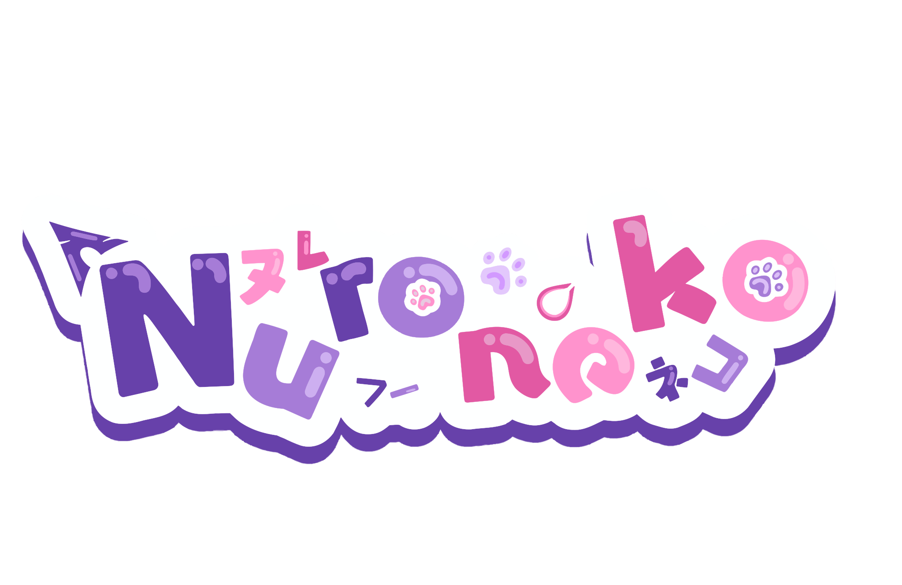
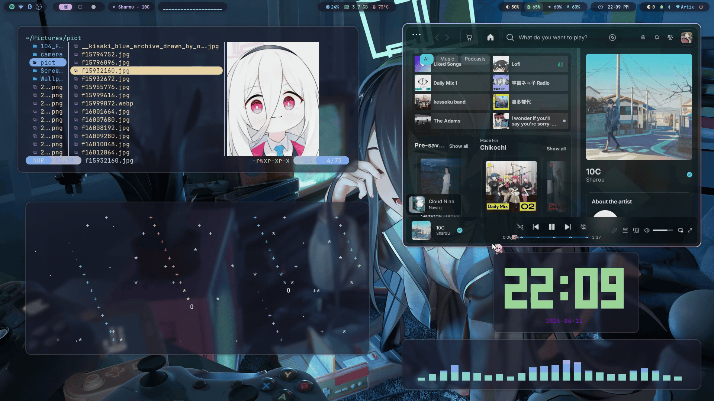
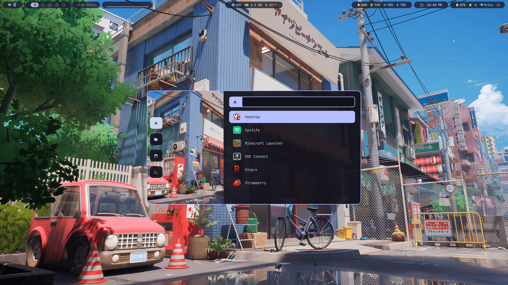
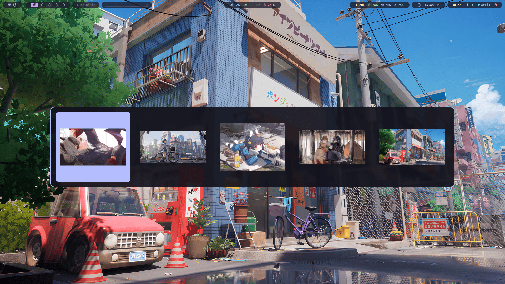
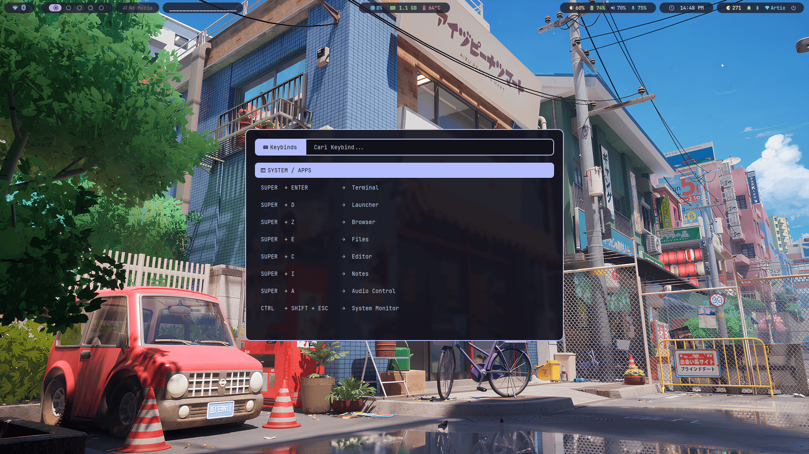

# Nuroneko

Nuroneko is a modular Hyprland environment for people who want a complete Arch Linux or Artix Linux desktop without manually assembling and maintaining dozens of separate configurations.

It provides a cohesive desktop workflow around Hyprland, including application launching, notifications, clipboard management, OCR utilities, screenshots, scratchpads, power management, shell tooling, SDDM theme integration, and desktop integration.

<p align="center">
  
</p>

<p align="center">
  <a href="https://github.com/AikoAii/nuroneko/commits">
    
  </a>

  <a href="https://github.com/AikoAii/nuroneko/stargazers">
    
  </a>

  <a href="./LICENSE">
    
  </a>
</p>

<p align="center">
  <a href="#why-nuroneko">Why Nuroneko</a> •
  <a href="#what-it-includes">What It Includes</a> •
  <a href="#preview">Preview</a> •
  <a href="#installation">Installation</a> •
  <a href="#documentation">Documentation</a>
</p>

---

## Why Nuroneko

Many Hyprland setups focus primarily on appearance.

While visually impressive, they often require users to manually maintain independent configurations for launchers, notifications, screenshots, clipboard utilities, shell environments, status bars, and supporting scripts.

Nuroneko approaches the desktop differently. Rather than treating each component as a separate system, it provides a curated environment where common workflows are integrated and designed to work together consistently across multiple init systems.

---

## What It Includes

Nuroneko provides a complete workflow around Hyprland, including:

* Application launching and desktop actions
* Clipboard history and clipboard utilities
* OCR and screenshot workflows
* Notification center and on-screen displays
* Scratchpad workflows and power profile management
* Wallpaper and appearance integration
* SDDM Display Manager integration (**NuroPix** theme)
* Terminal and shell tooling (Fish, Neovim, Starship, Yazi, Btop)

The project also includes an installation framework featuring:

* **Interactive Setup Wizard:** Menu engine using `whiptail`, `dialog`, or clean Bash CLI fallback
* **Multi-Init Integration:** Safe service management across `systemd`, `OpenRC`, and `dinit`
* **Safe Backups & Simulation:** Non-destructive deployment with timestamped backups & `--dry-run` simulation mode
* **Diagnostics Tool:** Standalone health & dependency checker (`./install.sh doctor`)

---

## Preview

<table align="center">
  <tr>
    <td colspan="3">
      <a href="https://youtu.be/w_LmZ3DnkMw?si=jRVfj1dQAXsSO_lg">
        
      </a>
    </td>
  </tr>

  <tr>
    <td>
      
    </td>
    <td>
      
    </td>
    <td>
      
    </td>
  </tr>
</table>

---

## Installation

Clone the repository:

```bash
git clone https://github.com/AikoAii/Nuroneko.git ~/.config/Nuroneko
cd ~/.config/Nuroneko
```

Standard installation (Interactive Wizard):

```bash
./install.sh
```

Simulation mode (Read-only Dry-Run):

```bash
./install.sh --dry-run
```

Development installation (Symlinks):

```bash
./install.sh --symlink
```

System diagnostics & health check:

```bash
./install.sh doctor
```

> [!NOTE]
> Existing configurations are automatically backed up before deployment to `~/.local/share/nuroneko/backups/`.

---

## Documentation

Additional documentation is available for:

- [Installation Guide](./docs/installation.md)
- [Package Reference](./docs/packages.md)
- [Shell Aliases](./docs/alias.md)
- [Shell Functions](./docs/functions.md)
- [Troubleshooting](./docs/troubleshooting.md)

Quick keybinding reference inside desktop: `SUPER + /`

---

## Contributing

Bug reports, documentation improvements, workflow suggestions, and pull requests are welcome.

When contributing, please ensure that changes remain consistent with the project's goals of maintainability, modularity, and cross-init compatibility.

---

## Credits

Nuroneko builds upon the work of many open-source projects and communities that make modern Linux desktops possible.

<!--Special thanks to the maintainers, contributors, and users of the software that forms the foundation of this project.-->

---


## Support Me

<p align="left">
  <a href="https://trakteer.id/aikoaii" target="_blank">
    
  </a>

  <a href="https://ko-fi.com/aikoai" target="_blank">
    
  </a>
</p>

## License

MIT License. See `LICENSE` for details.
